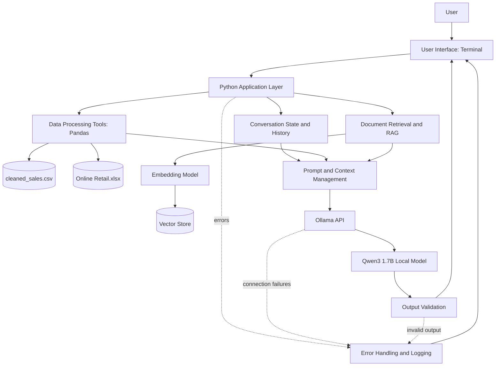

# Question 2: Architecture and Engineering Design

## System Architecture

## Component Responsibilities

1. User Interface: accepts questions and displays answers.
2. Python Application: coordinates data analysis, prompts, model calls, and errors.
3. Data Processing: uses Pandas to calculate sales figures from the retail dataset.
4. Conversation State: stores recent messages during the running session.
5. Retrieval and RAG: will search supporting documents and provide relevant context.
6. Ollama: runs the selected language model locally and generates explanations.
7. Validation: checks model responses before presenting them.
8. Persistent Storage: stores the original dataset and cleaned sales CSV.
9. Error Handling: handles invalid inputs, model connection problems, and malformed responses.

## Architectural Decisions

- A local Ollama model is used to support local inference without requiring a hosted LLM API.
- Python and Pandas perform numerical calculations instead of relying on the LLM for arithmetic.
- Conversation history will be managed by the application so multi-turn interactions can be supported.
- A retrieval component is planned to support evidence-based answers from documents.
- Output validation and error handling will improve reliability.
- CSV and Excel files provide persistent storage for the retail data. Conversation history is currently temporary and will be lost when the application exits unless persistence is added.

## Current Implementation Status

Implemented: terminal interface, Python data loading, preliminary sales analysis, CSV storage, and Ollama integration.

Planned: persistent conversation history, document ingestion, embeddings, vector storage, structured output validation, comprehensive logging, and web interface.
