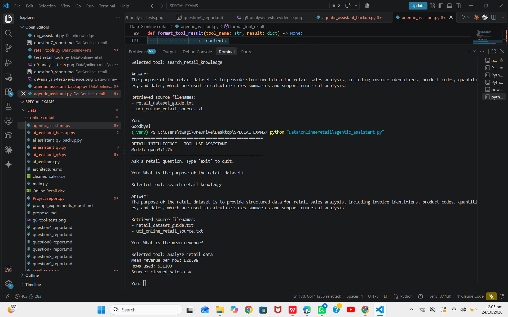

# Question 10: Streaming and User Experience

## 1. Objective

The objective of this task is to improve the user experience of the Retail Intelligence Tool-Use Assistant by implementing a responsive interaction mechanism.

## 2. Implementation

The assistant uses streaming to display the language model's generated answer progressively in the terminal. Instead of waiting for the complete response, the program processes the response in chunks and displays the received text using Python's `print()` function with `flush=True`.

The implementation uses the Ollama chat API with streaming enabled and Python's `requests` library to receive and process the response.

## 3. User Experience Improvements

- **Progressive responses:** The answer can appear as it is generated.
- **Interactive terminal:** Users can ask questions and receive responses in the same session.
- **Source transparency:** For knowledge-retrieval questions, the assistant displays the filenames of the retrieved knowledge sources.
- **Error handling:** The program handles request and JSON decoding errors during streaming.

## 4. Testing

The assistant was tested with the question:

"What is the purpose of the retail dataset?"

The assistant returned an explanation of the dataset's purpose and displayed the retrieved source filenames:
- `retail_dataset_guide.txt`
- `uci_online_retail_source.txt`

The screenshot below provides evidence of the test.

## 5. Screenshot Evidence

## 6. Conclusion

The streaming implementation improves responsiveness by allowing generated text to be displayed progressively in the terminal. This makes the assistant more interactive while preserving its knowledge-retrieval functionality and source transparency.