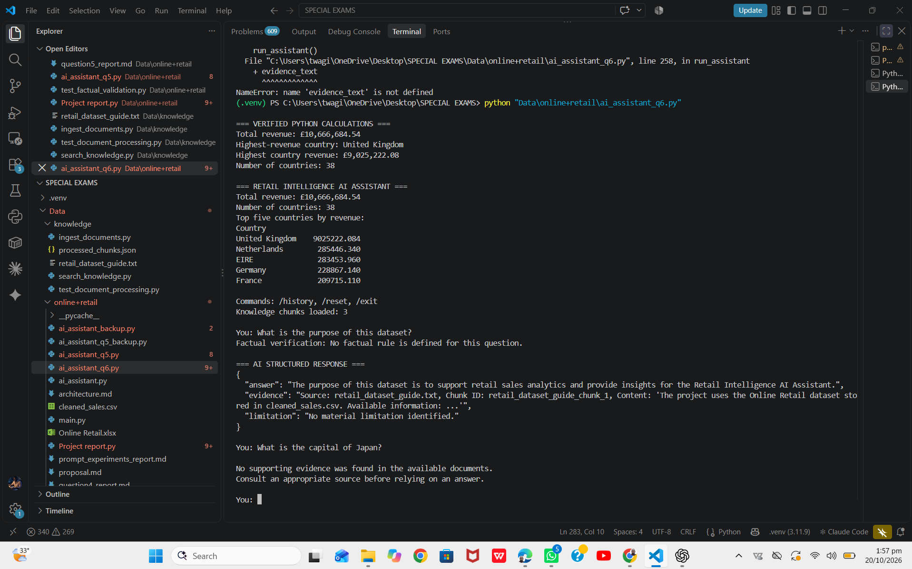
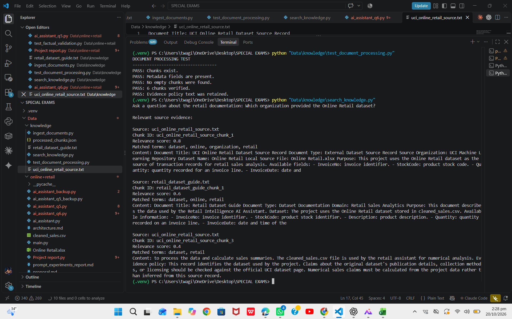

Question 6: Knowledge and Document Processing
Project
Retail Intelligence AI Assistant: An LLM-Powered System for Sales
Analysis and Knowledge Retrieval
1. Objective
The objective of Question 6 is to demonstrate how the application
processes source information and makes it available to an AI assistant.
The implementation covers document ingestion, text cleaning, chunking,
metadata management, retrieval, source attribution, structured output
validation, and handling questions for which no matching evidence is
found.
2. Implementation
2.1 Source documents
The knowledge folder contains two text documents:
- retail_dataset_guide.txt --- project documentation describing the
  dataset fields and the project's data-handling approach.
- uci_online_retail_source.txt --- a project-created source record
  identifying the Online Retail Excel file and the UCI Machine
  Learning Repository as the source named by the project.
The original Excel file, Online Retail.xlsx, is stored in
Data\online+retail. The application uses cleaned_sales.csv for its
existing numerical analysis.

Source limitation: uci_online_retail_source.txt was written for
this project. It is not the official UCI documentation. The source
attribution should be verified against the official UCI dataset page
before making claims about publication details, collection methods, or
licensing.
2.2 Document ingestion and preprocessing
The script Data\knowledge\ingest_documents.py reads .txt files in
the knowledge folder. It normalizes line endings, trims unnecessary
spaces, reduces repeated blank lines, and skips empty documents.
2.3 Chunking
The script splits cleaned text into smaller chunks with an overlap of
approximately 80 characters, using a target chunk size of approximately
500 characters. Overlap helps retain context between adjacent chunks.

The processed knowledge base contains six chunks in total: three from
each text document.
2.4 Metadata management
Each chunk is saved in processed_chunks.json with fields including:
- id --- chunk identifier.
- source --- source filename.
- document_type --- document type.
- chunk_index --- position of the chunk.
- total_chunks --- number of chunks in the document.
- char_count --- character count.
- content --- text extracted from the source document.
The stored content is source-derived text. It is kept distinct from
answers later generated by the language model.
2.5 Retrieval
The script Data\knowledge\search_knowledge.py performs keyword-based
retrieval. It removes common stop words, compares meaningful words from
a question with words in each chunk, calculates a keyword-match score,
and returns the highest-scoring chunks with their source filenames and
chunk IDs.

The Q6 assistant, Data\online+retail\ai_assistant_q6.py, loads the
processed chunks and supplies retrieved evidence to the Ollama model.
Its structured response contains three fields: answer, evidence, and
limitation.
2.6 Validation and missing evidence
The assistant validates the JSON response and rejects responses when
required fields are missing or empty. When keyword retrieval returns no
matching chunks, the assistant reports that no supporting evidence was
found and does not send that question to Ollama.

This safeguard is conservative, but it does not prove that every
retrieved chunk fully supports an answer. Keyword retrieval may miss
relevant content that uses different wording, or return a chunk that
shares words with a question without answering it.
3. Testing and Results
The following tests were performed during implementation:
  Test                                Observed result
  Run document ingestion              Both text files processed; six
                                      chunks created

  Test processed chunks               Passed: chunks existed, metadata
                                      was present, no empty chunks were
                                      found, and six chunks were verified

  Search for the dataset source       Retrieved
  organization                        uci_online_retail_source.txt and
                                      displayed the source and chunk ID

  Search for the dataset purpose      Retrieved relevant text from the
                                      project guide and source record

  Ask "Which organization provided    Returned "UCI Machine Learning
  the Online Retail dataset?" in the  Repository" with a source filename
  Q6 assistant                        and chunk ID

  Ask "What is the purpose of this    Initially produced an invalid
  dataset?"                           response with an empty evidence
                                      field; the validator correctly
                                      rejected it. A later test returned
                                      a valid structured response with
                                      source attribution

  Ask "What is the capital of Japan?" Reported that no supporting
                                      evidence was found and did not
                                  generate an answer from the model
Screenshots of the successful supported-question and missing-evidence
tests were saved by the student and should be inserted into the final
assignment submission.

### Screenshot 1: Successful source-based answer

### Screenshot 2: Missing-evidence handling

4. Evidence and limitations
The implementation demonstrates a basic document-processing and
source-retrieval workflow. It keeps source text and generated answers
separate, tracks chunk metadata, includes source attribution in
successful responses, and handles questions with no matching retrieved
evidence.

The main limitations are:
1. Retrieval is based on keyword overlap, not semantic embeddings or
   vector similarity.
2. A keyword match score indicates term overlap, not the truth or
   completeness of an answer.
3. The project-created UCI source record is not independent proof of
   the dataset's official provenance. The official UCI dataset page
   should be consulted and cited in the final submission.
4. The missing-evidence check only detects cases where no chunks match.
   A question may still receive matching text that does not fully
   support the requested claim.
5. The original Excel dataset is used as the project's data source,
   while the existing sales calculations use cleaned_sales.csv.
5. Conclusion
Question 6 has been implemented as a basic knowledge and
document-processing workflow. The application ingests and cleans text
documents, splits them into overlapping chunks, stores metadata,
retrieves source excerpts, provides evidence to Ollama, validates
structured output, and reports when no matching evidence is found. The
tests confirmed these behaviors for the cases tried.

The work should be described as a keyword-based retrieval prototype, not
a complete semantic RAG pipeline. The official UCI source should be
verified for the final report, and the limitations above should be
acknowledged. Semantic embeddings, vector indexing, and similarity-based
retrieval are separate capabilities to be addressed in the RAG work for
Question 7.