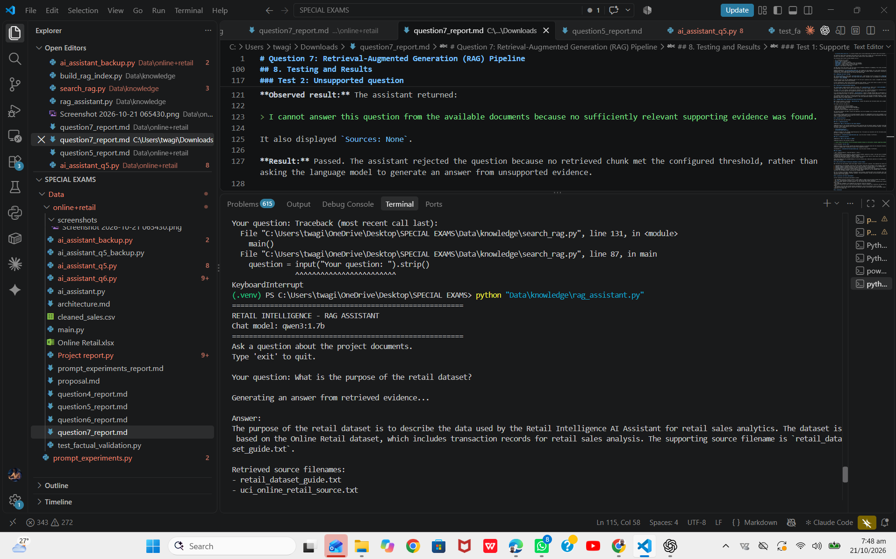
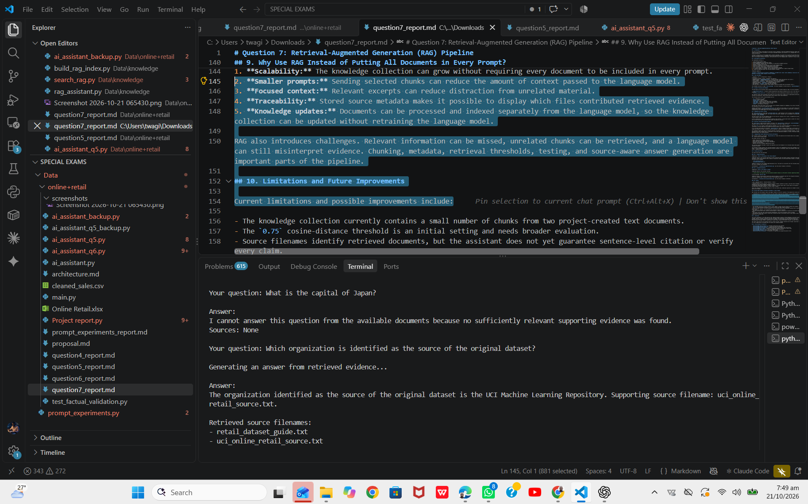

# Question 7: Retrieval-Augmented Generation (RAG) Pipeline

## 1. Introduction

This part of the Retail Intelligence AI Assistant project implements a Retrieval-Augmented Generation (RAG) pipeline. The system retrieves relevant information from project knowledge documents and provides it to a language model as context for answering questions.

Instead of relying only on the language model's general knowledge, the system first searches the available documents. It then uses the retrieved evidence to generate an answer and displays the filenames of the retrieved sources. If no retrieved result meets the configured relevance threshold, the system does not ask the language model to generate a factual answer.

## 2. RAG Pipeline Architecture

The implemented workflow is:

1. Load processed document chunks.
2. Generate embeddings for the document chunks.
3. Store embeddings, document text, and metadata in a persistent ChromaDB collection.
4. Receive a question from the user.
5. Generate an embedding for the question using the same embedding model.
6. Search the vector collection for semantically similar chunks.
7. Filter retrieved results using a cosine-distance threshold.
8. If no result passes the threshold, return a missing-evidence message.
9. If relevant evidence is available, pass the question and retrieved text to Qwen3 through Ollama.
10. Display the generated answer and retrieved document filenames.

**Pipeline summary:**

`Documents → Preprocessing and chunking → Embeddings → ChromaDB vector index → Query embedding → Similarity retrieval → Relevance filtering → Qwen3 response → Source filenames`

## 3. Tools and Models

| Component | Tool or configuration | Purpose |
|---|---|---|
| Programming language | Python | Implements the pipeline |
| Embedding model | `embeddinggemma:latest` | Converts document chunks and questions into vectors |
| Vector database | ChromaDB | Persists vectors, document text, and metadata |
| Language model | `qwen3:1.7b` | Generates answers from retrieved evidence |
| Local model service | Ollama | Serves embedding and chat requests |
| Embedding endpoint | `/api/embed` | Generates embeddings |
| Chat endpoint | `/api/chat` | Generates the final answer |
| Retrieval metric | Cosine distance | Ranks semantic similarity between query and document vectors |

The ChromaDB collection is named `retail_knowledge`. The vector database is stored locally in `Data/knowledge/chroma_db`.

## 4. Document Processing and Metadata

The RAG pipeline uses processed chunks produced by the project's document-ingestion stage. The source documents include:

- `retail_dataset_guide.txt` — project-created documentation describing the dataset and its use in the retail analysis assistant.
- `uci_online_retail_source.txt` — a project-created source record identifying the dataset used by the project.

The ingestion stage cleans whitespace and divides text into chunks with a target size of approximately 500 characters and an overlap of 80 characters. Chunk overlap helps retain context across chunk boundaries.

The processed chunk records include metadata such as:

- `id` — identifier for a chunk.
- `source` — source filename.
- `document_type` — type of document.
- `chunk_index` — position of the chunk within its document.
- `total_chunks` — total number of chunks from that document.
- `char_count` — number of characters in the chunk.
- `content` — text content of the chunk.

The RAG index stores each chunk's text and useful source metadata alongside its embedding. This allows retrieved results to be traced back to the source filename and chunk.

**Source limitation:** `uci_online_retail_source.txt` was created for this project. It is not itself official UCI documentation. Claims requiring authoritative information about the original dataset's publication, collection methods, or licensing should be checked against the official UCI dataset page.

## 5. Embeddings and Vector Storage

The `build_rag_index.py` script reads `processed_chunks.json`, sends batches of text to Ollama using `embeddinggemma:latest`, and receives their embedding vectors. The script stores the vectors, document text, and metadata in the persistent ChromaDB collection `retail_knowledge`.

The query process uses the same embedding model to turn the user's question into a vector. ChromaDB then retrieves the closest document chunks using cosine distance.

In this configuration, lower cosine distances indicate closer matches. A close vector match is useful for retrieval, but does not by itself prove that the retrieved text answers the question correctly.

## 6. Retrieval and Missing-Evidence Handling

The `search_rag.py` module performs semantic retrieval. The `rag_assistant.py` module calls `search_knowledge()` to retrieve candidate chunks and keeps results whose cosine distance is less than or equal to `0.75`.

The value `0.75` is an initial, project-specific threshold. It is not a universal definition of relevance and should be calibrated by testing supported and unsupported questions against the project's documents.

If no retrieved chunk passes the threshold, `rag_assistant.py` returns a message stating that no sufficiently relevant supporting evidence was found. It does not send the question to Qwen3 for factual answer generation in that case.

This safeguard reduces the chance of answering questions unrelated to the available knowledge documents. It does not guarantee that every accepted chunk is sufficient or that every generated statement is correct. Retrieved evidence and generated answers still need evaluation.

## 7. Language Model Answer Generation and Source Attribution

When relevant evidence is retrieved, `rag_assistant.py` formats the question and retrieved chunks into a prompt for `qwen3:1.7b`, served locally through Ollama.

The prompt instructs the model to:

- Answer using only the supplied evidence.
- Avoid inventing facts or using outside knowledge.
- State when the evidence does not answer the question.
- Provide a concise answer.
- Identify the source filenames supporting the answer.

The assistant displays the model's answer and separately lists the filenames of all retrieved chunks that passed the relevance threshold.

The displayed filenames identify the retrieved documents; they do not independently verify every statement in the generated answer. A future improvement could include more precise citations to individual chunks and automated checks that each factual claim is supported by the cited text.

## 8. Testing and Results

Two end-to-end tests were performed.

### Test 1: Supported question

**Question:** `What is the purpose of the retail dataset?`

**Observed result:** The assistant generated an answer explaining that the dataset supports the Retail Intelligence AI Assistant's retail sales analytics and is based on transaction records from the Online Retail dataset. It displayed these retrieved source filenames:

- `retail_dataset_guide.txt`
- `uci_online_retail_source.txt`

**Result:** Passed for the intended supported-question test. The answer was consistent with the retrieved project documents, and source filenames were displayed.

### Test 2: Unsupported question

**Question:** `What is the capital of Japan?`

**Observed result:** The assistant returned:

> I cannot answer this question from the available documents because no sufficiently relevant supporting evidence was found.

It also displayed `Sources: None`.

**Result:** Passed. The assistant rejected the question because no retrieved chunk met the configured threshold, rather than asking the language model to generate an answer from unsupported evidence.

### Test 3: Dataset source identification

**Question:** `Which organization is identified as the source of the original dataset?`

**Observed result:** The assistant identified the UCI Machine Learning Repository and displayed `uci_online_retail_source.txt` as a supporting source filename.

**Result:** Passed for this test. The answer was consistent with the project-created source record retrieved by the RAG pipeline.

**Limitation:** The source record was created for this project and is not itself official UCI documentation. The result demonstrates retrieval from the project's knowledge base, not independent verification against the official dataset page.

| Dataset source identification | Retrieve relevant evidence, answer the question, and show the source filename | UCI Machine Learning Repository identified; source filename displayed | Passed |

### Test summary

| Test | Expected behavior | Observed behavior | Status |
|---|---|---|---|
| Supported dataset-purpose question | Retrieve relevant evidence, generate an answer, and show source filenames | Answer generated and two source filenames displayed | Passed |
| Unsupported Japan-capital question | Refuse to generate a factual answer when no result meets the threshold | Missing-evidence message displayed; no sources listed | Passed |

These tests demonstrate the intended behavior for the two tested cases. Additional questions are needed to evaluate retrieval quality more broadly.

## 9. Why Use RAG Instead of Putting All Documents in Every Prompt?

RAG retrieves only the document chunks that appear relevant to the user's question. This approach has several advantages:

1. **Scalability:** The knowledge collection can grow without requiring every document to be included in every prompt.
2. **Smaller prompts:** Sending selected chunks can reduce the amount of context passed to the language model.
3. **Focused context:** Relevant excerpts can reduce distraction from unrelated material.
4. **Traceability:** Stored source metadata makes it possible to display which files contributed retrieved evidence.
5. **Knowledge updates:** Documents can be processed and indexed separately from the language model, so the knowledge collection can be updated without retraining the language model.

RAG also introduces challenges. Relevant information can be missed, unrelated chunks can be retrieved, and a language model can still misinterpret evidence. Chunking, metadata, retrieval thresholds, testing, and source-aware answer generation are important parts of the pipeline.

## 10. Limitations and Future Improvements

Current limitations and possible improvements include:

- The knowledge collection currently contains a small number of chunks from two project-created text documents.
- The `0.75` cosine-distance threshold is an initial setting and needs broader evaluation.
- Source filenames identify retrieved documents, but the assistant does not yet guarantee sentence-level citation or verify every claim.
- More supported, ambiguous, and unsupported test questions should be evaluated.
- Retrieval precision and recall could be assessed against a manually prepared set of questions and expected supporting chunks.
- The project could later add trusted external documentation, with source provenance clearly recorded.
- The assistant could return explicit chunk-level citations and add a verification step to check whether answer claims are supported by retrieved text.

## 11. Conclusion

The project implements a local RAG pipeline that combines document chunking, Ollama embeddings, persistent ChromaDB vector storage, semantic retrieval, relevance filtering, and Qwen3 answer generation. In the supported-question test, the assistant generated an answer and displayed retrieved source filenames. In the unsupported-question test, it returned a missing-evidence message instead of generating a factual answer without sufficiently relevant retrieved context.

The results show that the core pipeline works for these two tests. Broader evaluation and stronger claim-level verification are still needed before concluding that all answers are reliably grounded.

## 12. Files Relevant to Question 7

- `Data/knowledge/ingest_documents.py` — document preprocessing and chunking.
- `Data/knowledge/processed_chunks.json` — processed chunks and metadata.
- `Data/knowledge/build_rag_index.py` — embedding generation and ChromaDB index construction.
- `Data/knowledge/search_rag.py` — semantic retrieval and relevance filtering for search tests.
- `Data/knowledge/rag_assistant.py` — retrieval-augmented answer generation.
- `Data/knowledge/chroma_db/` — persistent local vector index.
- `Data/online+retail/screenshots/` — screenshots of supported and unsupported question tests.
