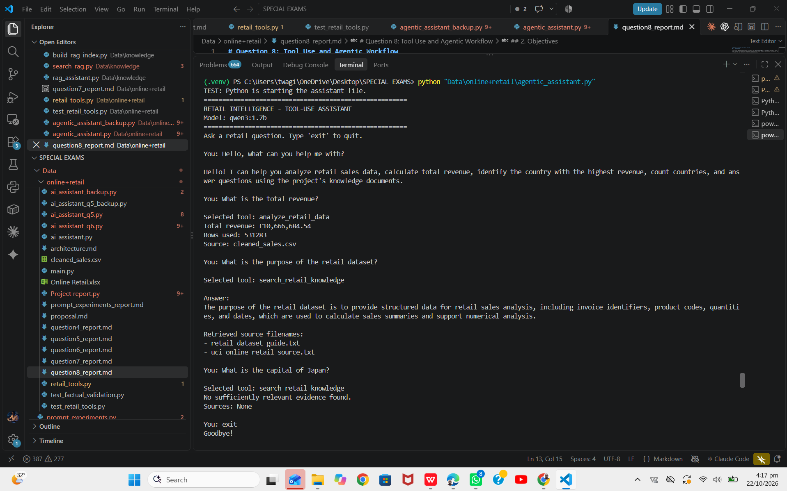
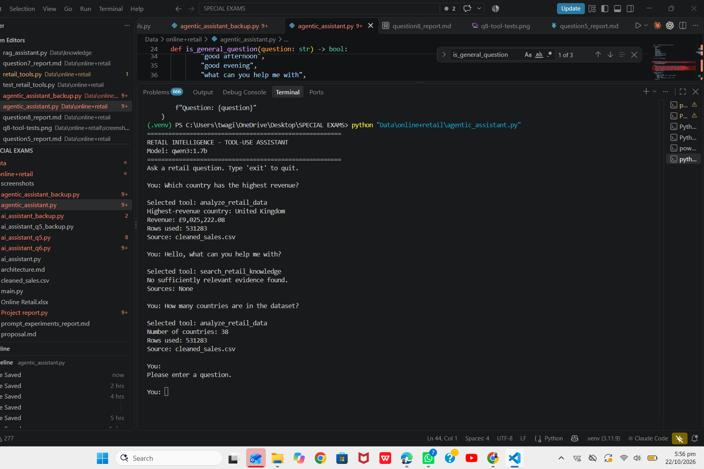

# Question 8: Tool Use and Agentic Workflow

## 1. Introduction

This section implements a tool-using workflow for the **Retail Intelligence AI Assistant**. Instead of asking the language model to answer every question from memory, the assistant can choose between a deterministic sales-analysis tool and a retrieval tool that searches the project's knowledge documents.

The implementation uses Python for calculations and tool execution, Ollama to run the local `qwen3:1.7b` model, and the project's existing RAG retrieval system for knowledge questions.

## 2. Objectives

The workflow is designed to:
- Select a suitable tool based on the user's question.
- Calculate numerical sales facts using Python and the cleaned sales CSV.
- Search project knowledge documents for questions about the dataset.
- Display retrieved source filenames for knowledge-based answers.
- Avoid unsupported answers when the knowledge search finds no sufficiently relevant evidence.
- Handle general greetings without unnecessarily calling a tool.

## 3. Architecture and workflow

The application follows this workflow:

1. Receive a question from the user.
2. Recognize general greetings and capability questions and respond directly when appropriate.
3. For other questions, ask the local language model to select an approved tool.
4. Validate the selected tool name against an allowlist.
5. Execute the selected Python tool.
6. Format the result for the user.
7. If the knowledge search finds no sufficiently relevant evidence, return a missing-evidence message rather than inventing an answer.

**Workflow summary:**

`User question → General-question check → LLM tool selection → Allowlist validation → Tool execution → Result formatting → User response`

## 4. Tools implemented

### 4.1 `analyze_retail_data`

This tool reads `cleaned_sales.csv` using pandas and calculates supported numerical summaries from the data. The implemented analyses include:
- Total revenue.
- Country with the highest revenue.
- Number of countries.

The tool reports the number of valid rows used and identifies `cleaned_sales.csv` as its data source. These numerical facts are calculated by Python rather than generated by the language model.

### 4.2 `search_retail_knowledge`

This tool calls the project's RAG retrieval function to search the knowledge base. It returns retrieved text, source filenames, and retrieval metadata when sufficiently relevant evidence is available. The retrieval process uses the project's configured cosine-distance threshold of 0.75.

If no result meets the threshold, the tool reports that no sufficiently relevant evidence was found. The assistant then avoids generating an unsupported factual answer.

### 4.3 General response handling

The assistant recognizes common greetings and capability questions, such as “Hello, what can you help me with?” It responds directly with a short description of its capabilities rather than searching the knowledge base.

## 5. Tool selection and execution

The local `qwen3:1.7b` model is used to select a tool for questions that require analysis or knowledge retrieval. The application restricts execution to known, approved tool names rather than allowing the model to execute arbitrary code.

After selection, Python invokes the corresponding function. Numerical results are formatted from the tool output. Knowledge answers are generated using retrieved evidence, and source filenames are displayed to help the user trace the answer to the project documents.

## 6. Testing and observed results

The following tests were run interactively against the assistant.

### Test 1: General greeting

**Input:** `Hello, what can you help me with?`

**Observed result:** The assistant described its retail analysis and knowledge-document capabilities. It did not select a tool.

**Status:** Passed.

### Test 2: Total revenue

**Input:** `What is the total revenue?`

**Selected tool:** `analyze_retail_data`

**Observed result:**
- Total revenue: **£10,666,684.54**
- Rows used: **531,283**
- Source: `cleaned_sales.csv`

**Status:** Passed. The assistant displayed the deterministic result returned by the data-analysis tool.

### Test 3: Purpose of the retail dataset

**Input:** `What is the purpose of the retail dataset?`

**Selected tool:** `search_retail_knowledge`

**Observed result:** The assistant explained that the dataset provides structured information for retail sales analysis, including invoice identifiers, product codes, quantities, and dates. It displayed these retrieved source filenames:
- `retail_dataset_guide.txt`
- `uci_online_retail_source.txt`

**Status:** Passed for this supported-question test. The answer and source filenames were displayed.

**Source limitation:** `uci_online_retail_source.txt` is a project-created source record, not official UCI documentation. Its presence in the retrieved sources should not be treated as independent verification of claims about the original dataset.

### Test 4: Unsupported question

**Input:** `What is the capital of Japan?`

**Selected tool:** `search_retail_knowledge`

**Observed result:** `No sufficiently relevant evidence found. Sources: None`

**Status:** Passed. The assistant did not provide an unsupported factual answer from the project knowledge base.

### Test summary

| Test | Expected behavior | Observed behavior | Status |
|---|---|---|---|
| General greeting | Respond directly without a tool | Direct capability response | Passed |
| Total revenue | Use deterministic data analysis | £10,666,684.54 from 531,283 rows | Passed |
| Dataset purpose | Retrieve evidence and show sources | Answer and two source filenames displayed | Passed |
| Japan capital | Avoid unsupported knowledge-base answer | Missing-evidence message displayed | Passed |

These results demonstrate the tested behaviors only; they do not establish that every possible input will be handled correctly.

## 7. Reliability and limitations

The implementation includes several reliability measures:
- **Tool allowlist:** The model's selected tool name is checked against approved tools before execution.
- **Deterministic calculations:** Python computes numerical sales facts, reducing the risk of language-model arithmetic errors.
- **Missing-evidence handling:** The knowledge tool can report when no retrieved evidence meets the configured threshold.
- **Error handling:** The interactive workflow catches common connection and tool-workflow errors and displays messages rather than immediately terminating.
- **General-question handling:** Greetings and capability questions are handled without unnecessary retrieval.

Current limitations include:
- The tests completed so far cover four scenarios, not the full range of possible user inputs.
- The cosine-distance threshold of 0.75 is a project-specific setting and requires broader evaluation.
- Retrieved source filenames do not prove that every generated sentence is supported by the source.
- The tool selector may choose an inappropriate tool for ambiguous or unfamiliar questions.
- Ollama and the local knowledge index must be available for the corresponding tools to work.

## 8. Further tests recommended

Before final submission, test and record the actual outputs for these additional cases:

1. **Highest-revenue country:** Ask `Which country has the highest revenue?` and confirm the selected tool and calculated result.
2. **Number of countries:** Ask `How many countries are in the dataset?` and check the count.
3. **Empty input:** Press Enter without typing a question and confirm that the assistant asks for input.
4. **Ambiguous request:** Ask `Tell me about sales` and inspect whether the selected tool is appropriate.
5. **Missing or malformed data:** Test a safe copy of the dataset with a required column missing, and confirm the analysis tool reports an error rather than crashing.
6. **Ollama unavailable:** With permission and when safe to do so, test the behavior when the local model service is unavailable, then restart the service.
7. **Unexpected tool-selection output:** Test or simulate malformed model output and confirm that the application rejects invalid tool names.
8. **Unsupported knowledge question:** Repeat an unrelated question and confirm that the missing-evidence response remains consistent.

Do not report these recommended tests as passed until they have actually been run and their results recorded.

## 9. Files used

- `Data/online+retail/agentic_assistant.py` — interactive assistant and tool-selection workflow.
- `Data/online+retail/retail_tools.py` — deterministic sales analysis and knowledge-search tool wrappers.
- `Data/online+retail/cleaned_sales.csv` — cleaned retail transaction data.
- `Data/knowledge/search_rag.py` and the project's RAG index — knowledge retrieval implementation.
- `Data/knowledge/retail_dataset_guide.txt` — project dataset guide.
- `Data/knowledge/uci_online_retail_source.txt` — project-created source record.

## 10. Conclusion

The implemented workflow demonstrates tool use and a basic agentic pattern: the assistant routes user questions to approved capabilities, executes Python-based analysis or knowledge retrieval, and presents the resulting output. The four recorded tests passed for their intended scenarios: a greeting, total-revenue calculation, supported dataset-purpose question, and unsupported Japan-capital question.

The implementation is a working prototype. Broader testing of ambiguous inputs, error conditions, and tool-selection reliability is still required before making stronger claims about robustness.

## 11. Screenshot Evidence

The screenshot below shows the assistant's interactive tests, including the greeting response, total revenue calculation, knowledge retrieval, and missing-evidence handling.

