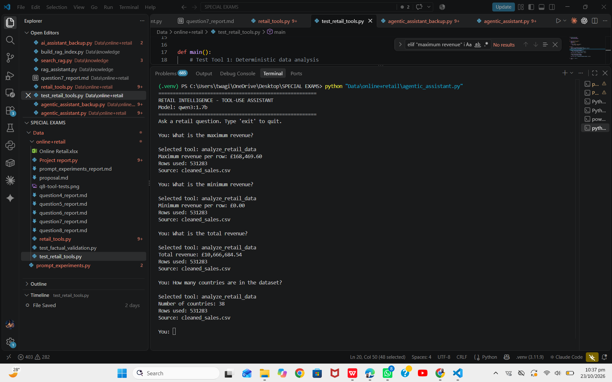
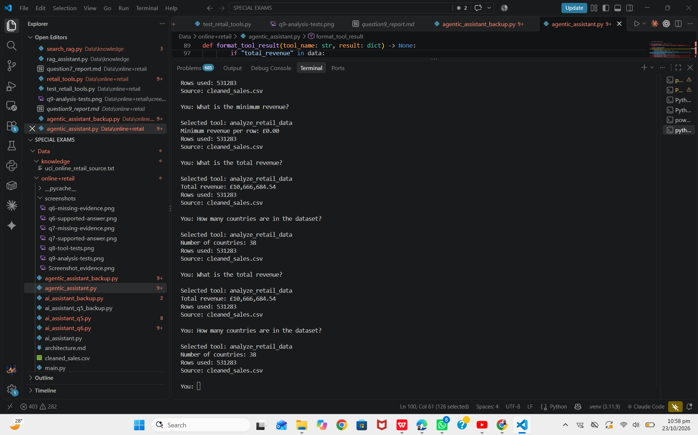

## Data Analysis Capability — Test Results

The retail assistant uses pandas to perform deterministic calculations on the structured `cleaned_sales.csv` dataset. The analysis functions calculate total revenue, mean and median revenue per row, maximum and minimum revenue per row, revenue by country, the number of countries, and monthly revenue trends.

These calculations are performed using Python code rather than relying on the language model to estimate numerical answers. The assistant displays the calculated results, the number of rows used, and the dataset source.

### Screenshot Evidence

